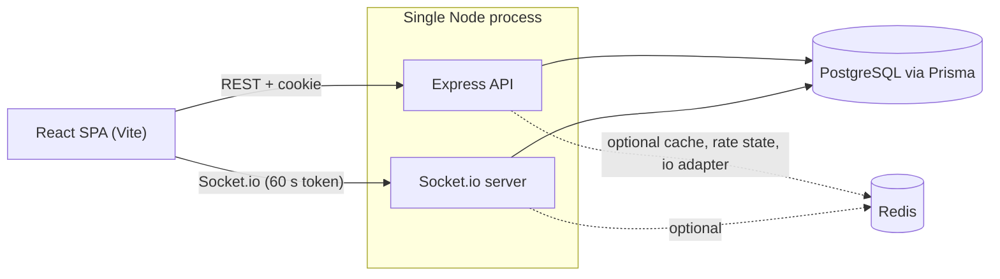
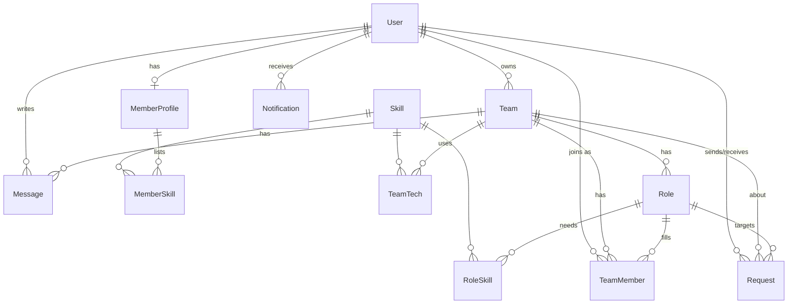

# Team Finder

Team Finder connects students who want to build with teams that need their skills. Members create a profile, browse teams and people, see a transparent **match score** for every role, and exchange join requests and invites. Accepted members get a live team chat, and everyone gets real-time notifications.

One account can be both a member and a team owner; a **Member / Team owner** switch in the navbar changes the emphasis of the dashboard and navigation without changing permissions.

## Features

1. **Auth and role switch** – register, log in, log out; bcrypt passwords, JWT in an httpOnly cookie, session survives refresh; persistent Member ↔ Team owner mode.
2. **Profiles** – onboarding wizard and profile editor with skills catalogue (free-add), level, availability, goals and a server-computed completeness bar; create, edit and delete teams with roles, slots and skill requirements.
3. **Browse and filter** – people (skills any/all, level, minimum hours, looking-for, text) and teams (tech stack, open-role skills, type, deadline, text); server-side pagination, URL-synced and shareable filters, debounced search, cached results.
4. **Match score** – deterministic 0–100 score (skills 60 %, level 15 %, availability 15 %, project type 10 %) with a breakdown and matched/missing skills; owners can rank people by a chosen role; recommendations for both sides.
5. **Two-way requests** – members request a role, owners invite people; accept, decline or cancel. Every transition is enforced server-side in a transaction, so two accepts for the last slot give exactly one success and one `409`.
6. **Dashboard** – Received / Sent / History tabs with live counts, summary cards, per-team owner panels with incoming requests and recommended people; inline actions with optimistic updates and live refresh.
7. **Notifications** – live bell with unread count, dropdown, full page, mark one/all read; request events, role filled, team closed, member removed and `NEW_MATCH` (≥ 70 %).
8. **Team management and chat** – mark a role filled, reopen, remove members, leave; the team closes automatically when every role is filled and returns when one is reopened. Team chat with persisted paginated history, typing indicator, online presence and unread badges; non-members are blocked on both REST and sockets.

## Tech stack

React 19, Vite, React Router, Tailwind CSS v4, TanStack Query, React Hook Form + Zod, socket.io-client, lucide-react · Node.js 22, Express 5, Zod 4, Prisma 7 (PostgreSQL), Socket.io, ioredis (optional), pino, helmet, express-rate-limit · Vitest, Supertest, React Testing Library. Plain modern JavaScript (ES modules) throughout.

## Architecture



Backend layering per feature module (`auth`, `members`, `teams`, `skills`, `requests`, `notifications`, `chat`, `dashboard`, `match`, `public`): `routes → controller → service → prisma/cache`. Business rules live only in services; controllers shape responses. Shared code is in `server/src/lib` (`match.js` is the pure scoring function) and `server/src/middleware`.

Key design points:

- **Auth:** JWT in the `tf_token` httpOnly cookie (`Secure; SameSite=None` in production, `Lax` when the API serves the client). Sockets authenticate with a 60-second token from `GET /api/auth/socket-token`, so they work even when third-party cookies are blocked.
- **Race safety:** accepting a request locks the role row and then the request row (`SELECT … FOR UPDATE`) inside one transaction; a partial unique index also forbids duplicate pending requests.
- **Caching:** Redis is optional. Browse lists are cached per filter hash under a version counter that is bumped on writes (no key scanning); viewer-specific data (match, relation, pending requests) is added after the cache. Without Redis everything works uncached; if Redis dies mid-run requests still succeed.
- **Real-time:** `notification:new`, `requests:changed`, `team:changed`, `chat:*` events map to TanStack Query invalidations on the client.



## Getting started

Prerequisites: Node.js 22+, npm 10+, PostgreSQL 16 (Redis optional).

```bash
# 1. services (pick one)
docker compose up -d                      # Postgres + Redis
# or without Docker, see the comments in docker-compose.yml

# 2. configuration
cp server/.env.example server/.env        # edit JWT_SECRET (32+ chars)
cp client/.env.example client/.env
# create a second database named teamfinder_test for the test suite (see docker-compose.yml)

# 3. install, create schema, seed demo data
npm ci
npm run db:migrate                        # prisma migrate dev
npm run db:seed                           # prints the demo credentials

# 4. run
npm run dev                               # API on :4000, client on :5173
```

`npm run db:reset` drops the database, re-applies the migrations and re-seeds.

### Demo credentials

Every demo account uses the password **`Password123!`**.

| Email | Who | Good for |
|---|---|---|
| `alice@demo.dev` | Alice Johnson, owns *AI Study Buddy* | owner view: 3 pending requests, chat history |
| `judy@demo.dev` | Judy Chen, frontend dev | member view: 2 pending invites, 100 % match for Alice's Frontend role |
| `bob@demo.dev`, `carol@demo.dev`, `dave@demo.dev`, `erin@demo.dev` | team owners | browse variety |
| `frank@demo.dev` | owns *Ledger Lite* (closed, all roles filled) | auto-close example |
| `grace`, `heidi`, `ivan`, `ken`, `lena` `@demo.dev` | other members | requests, matches |

Try it with two browsers: log in as Judy and Alice, let Judy request the Designer role, watch Alice's bell light up, accept, then chat.

### Scripts

| Script | What it does |
|---|---|
| `npm run dev` | client and server together |
| `npm run build` | `prisma generate` + production client build |
| `npm run lint` | ESLint (both workspaces) |
| `npm test` | Vitest (server against a real Postgres, client with jsdom) |
| `npm run coverage -w server` | server coverage report |
| `npm run db:migrate` / `db:seed` / `db:reset` | database tasks |

### Environment variables

**`server/.env`**

| Variable | Default | Description |
|---|---|---|
| `NODE_ENV` | `development` | `production` enables `Secure` cookies and `trust proxy` |
| `PORT` | `4000` | HTTP port |
| `DATABASE_URL` | – (required) | PostgreSQL connection string |
| `REDIS_URL` | empty | optional; empty disables Redis |
| `JWT_SECRET` | – (required) | at least 32 characters |
| `CLIENT_ORIGIN` | `http://localhost:5173` | comma-separated CORS / socket allowlist |
| `COOKIE_DOMAIN` | empty | set only to share cookies across subdomains |
| `SERVE_CLIENT` | `false` | `true`: Express also serves `client/dist` |

**`client/.env`**

| Variable | Description |
|---|---|
| `VITE_API_URL` | API base URL, for example `http://localhost:4000`; leave empty when the API serves the client |

## API summary

All routes are under `/api`, JSON in and out, errors as `{ "error": { "code", "message", "details?" } }`.

| Area | Endpoints |
|---|---|
| Auth | `POST /auth/register`, `/auth/login`, `/auth/logout` · `GET /auth/me`, `/auth/socket-token` |
| Skills | `GET /skills?q=&ids=` · `POST /skills` |
| Members | `GET/PUT /members/me` · `GET /members` (browse) · `GET /members/:userId?roleId=` |
| Teams | `GET/POST /teams` · `GET /teams/mine` · `GET/PATCH/DELETE /teams/:id` · `POST /teams/:id/roles` · `PATCH/DELETE /teams/:id/roles/:roleId` · `POST …/roles/:roleId/mark-filled` and `/reopen` · `DELETE /teams/:id/members/:userId` · `POST /teams/:id/leave` |
| Match | `GET /match?roleId=&userId=` · `GET /match/recommendations/members?roleId=` · `GET /match/recommendations/teams` |
| Requests | `POST /requests/join` and `/invite` · `POST /requests/:id/accept`, `/decline`, `/cancel` · `GET /requests?box=&status=&teamId=` |
| Dashboard | `GET /dashboard/summary`, `/owner`, `/member` |
| Notifications | `GET /notifications` · `GET /notifications/unread-count` · `POST /notifications/:id/read`, `/read-all` |
| Chat | `GET/POST /teams/:id/messages` · Socket.io `chat:join`, `chat:leave`, `chat:send`, `chat:typing` |
| Public | `GET /public/featured-teams`, `/public/stats` · `GET /health` |

The match formula is documented in [docs/05-MATCHING-ALGORITHM.md](docs/05-MATCHING-ALGORITHM.md); socket events in [docs/06-REALTIME-AND-CACHE.md](docs/06-REALTIME-AND-CACHE.md).

## Testing

```bash
npm test
```

The server suite (125 tests, about 96 % line coverage) runs Supertest and real `socket.io-client` connections against a PostgreSQL database named `teamfinder_test` (override with `TEST_DATABASE_URL`); Redis is not needed. It covers auth, validation, skills, profiles, teams, the match engine, browse filters, the requests state machine including the last-slot race, notifications, team management, chat, security (no emails or password hashes in any DTO, CORS, helmet, cookie flags, rate limit) and Redis fallback. The client suite covers the match ring, skill combobox, login form, route guard, mode switch, request rows, browse URL sync, notification bell, chat composer and the roles builder.

## Deployment

Target: **Vercel** (client) + **Render** (API) + **Neon** (PostgreSQL) + **Upstash** (Redis, optional). Config files: `render.yaml`, `client/vercel.json`.

1. **Neon:** create a project and copy the pooled connection string with `?sslmode=require`.
2. **Render:** create a Blueprint from `render.yaml`; set `DATABASE_URL`, optionally `REDIS_URL`, and `CLIENT_ORIGIN` (the Vercel URL). The start command runs `prisma migrate deploy` before the server. Free instances sleep, so the first request can take up to a minute; the client shows a "waking up the server" banner after 3 s.
3. **Vercel:** import the repo with root directory `client`, set `VITE_API_URL` to the Render URL. Put the resulting Vercel URL into Render's `CLIENT_ORIGIN` and redeploy the API.
4. **Seed (optional, idempotent):** `DATABASE_URL=<neon url> npm run db:seed`.

**Safari / blocked third-party cookies.** The cross-site setup needs third-party cookies for the REST session. The recommended alternative is the single-service mode: `render.single.yaml` builds the client with an empty `VITE_API_URL` and runs the API with `SERVE_CLIENT=true`, so the app and API share one origin and cookies are first-party. Locally: `VITE_API_URL= npm run build && SERVE_CLIENT=true npm start -w server`.

Post-deploy smoke test: `GET /api/health` returns `db: true`; register and finish onboarding; log in as `alice@demo.dev` (if seeded); in two browsers send a request, accept it and chat.

### Live demo

Not deployed from this build session: the configuration above is ready, so add the URLs after deploying.

- Frontend: `https://<your-app>.vercel.app`
- API: `https://<your-api>.onrender.com`
- Repository: <https://github.com/Powel29/team-finder>

## Known limitations

- The chat rate limit and the Express rate limiters keep their counters in memory, so they are per instance.
- Presence and room membership are correct across instances only when `REDIS_URL` is set (Socket.io Redis adapter).
- There is no committed Playwright end-to-end spec; the golden path was verified manually in two browser contexts.
- Email delivery, OAuth, file uploads and an admin panel are out of scope by design.

## Project documents

`docs/` holds the planning documents the build followed; `PROGRESS.md` tracks the phases and `DECISIONS.md` records the decisions made along the way.
